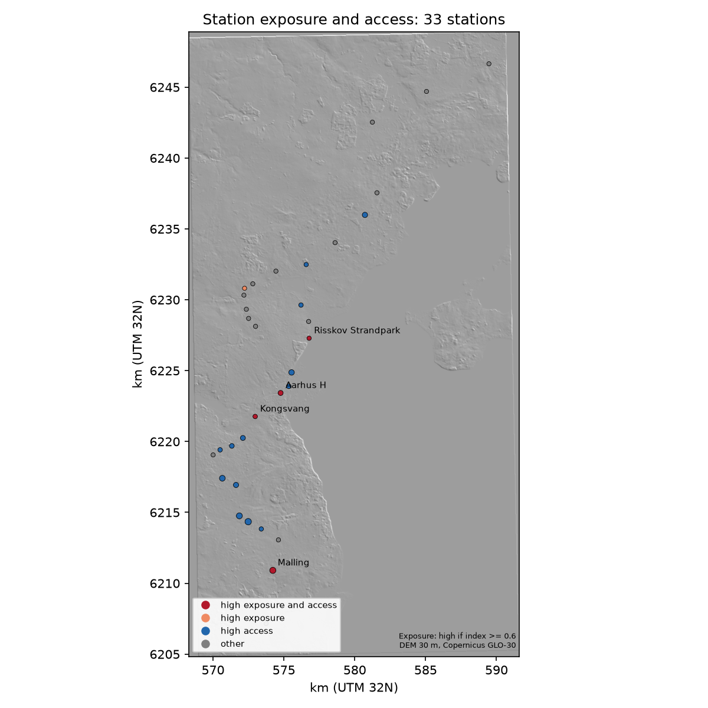

# Station climate access (GIS demo)

A screening index for metro and light-rail stations in Denmark. For each station it answers two questions:

1. **Exposure:** is the station low ground compared with its surroundings, so that surface water from a cloudburst could collect there?
2. **Access:** how many residential buildings lie within 400 m and 800 m walking distance?

Stations that score high on both are the ones where climate adaptation protects the most people's access to public transport.

Covered networks: **Aarhus Letbane** (light rail) and **Copenhagen Metro**. Portfolio project, 2026, by Bogdan Andone.

> This is a **screening index, not a hydraulic or flood model.** It uses only the terrain surface and building footprints. It does not model rainfall, drains, sewers, or water flow.

## What it does

| Step | What happens | Source (no key needed) |
|---|---|---|
| Stations | Overpass query for railway station/halt nodes with `light_rail=yes` (Aarhus) or `station=subway` (Copenhagen). Snapshots are committed in `data/raw/`. | OpenStreetMap via Overpass API |
| Terrain | Copernicus DEM GLO-30, read as windowed HTTP range requests (no full tile download), reprojected to ETRS89 / UTM 32N at 30 m. | Copernicus DEM, AWS bucket `copernicus-dem-30m` |
| Exposure | Within 250 m of each station: mean ring elevation minus station elevation (depression, m), share of ring cells higher than the station (%), and a combined index in 0 to 1 (`0.5 * share + 0.5 * min(depression / 5 m, 1)`). Index ≥ 0.6 counts as high exposure. | Derived |
| Access | Count of residential building centroids (OSM `building=apartments, residential, house, detached, terrace, ...`) within 400 m and 800 m, straight-line. Access is high when the 800 m count is at or above the city median. | OpenStreetMap buildings |
| Output | Ranking CSV, GeoJSON of stations, folium HTML map, PNG map on a hillshade. | — |

The thresholds (250 m ring, index 0.6, 5 m full depression, 400/800 m access) were fixed before the first run and are in `src/sca/config.py`. They were not tuned to the output.

## Run it

```bash
pip install -e ".[dev]"
python -m sca run --city aarhus
python -m sca run --city copenhagen
python -m sca run --city all --offline   # cached Overpass data only, writes ranking_all_cities.csv
```

Outputs go to `output/<city>/` (`ranking.csv`, `stations.geojson`, `map.html`, `map.png`). Raw Overpass responses for buildings are cached under `data/cache/` (not committed). Tests run offline: `pytest -q`.

## Results from the committed run

Run on 28 October 2026 with OSM data as it stood that day. Full table: [`output/aarhus/ranking.csv`](output/aarhus/ranking.csv), [`output/copenhagen/ranking.csv`](output/copenhagen/ranking.csv).

| | Aarhus Letbane | Copenhagen Metro |
|---|---:|---:|
| Stations | 33 | 44 |
| High exposure (index ≥ 0.6) | 5 | 21 |
| High exposure and high access | 4 | 8 |
| Median residential buildings within 800 m | 19 | 335 |
| Highest 800 m count | Mårslet (618) | Amager Strand (1,036) |

**Aarhus, high exposure and high access:** Kongsvang (index 0.88, 68 buildings within 800 m), Aarhus H (0.83, 211), Risskov Strandpark (0.81, 22), Malling (0.75, 534).

**Copenhagen, high exposure and high access:** Nørrebros Runddel (index 0.99, 465 buildings within 800 m), Enghave Plads (0.99, 518), Lergravsparken (0.98, 569), Trianglen (0.92, 528), Nuuks Plads (0.91, 363), Øresund (0.74, 666), Nørrebro (0.66, 380), Vibenhus Runddel (0.61, 450).

Maps: [Aarhus](output/aarhus/map.png) · [Copenhagen](output/copenhagen/map.png) · interactive: [`output/aarhus/map.html`](output/aarhus/map.html), [`output/copenhagen/map.html`](output/copenhagen/map.html)



## Honest limits

- **The DEM is a surface model.** Copernicus GLO-30 includes buildings and trees. In dense city centres a station on a street sits below the surrounding roofs, so it reads as a "pit" even where water would not pool. **This is the main reason Copenhagen has 21 high-exposure stations and Aarhus only 5.** The two cities' exposure rates are not directly comparable. Compare stations within a city, and treat Copenhagen's centre flags with particular caution.
- **Copenhagen Metro is largely underground.** The DEM describes the street or ground above the station, not the station box. The exposure of an underground station depends on its entrances and shafts, which this index does not see.
- **30 m resolution.** A station's immediate elevation is an average over a 30 m cell. Kerbs, embankments and cuttings narrower than that are invisible.
- **No flow or rainfall.** The index is topographic only. It does not route water, use drains, and it does not use DMI rainfall data (not included in this version).
- **OSM completeness.** Building counts depend on how completely OSM maps residential buildings, which varies between municipalities. Rural stations with 0 to 20 buildings may be under-mapped.
- **Counts, not people.** The access measure is a count of residential buildings, not residents. Summing the 800 m counts across stations double-counts buildings near several stations, so no total is reported.

## Next steps (not done here)

- Replace the Copernicus surface with the Danish national terrain model (DHM/terræn, bare earth) once a no-key download route is confirmed, which would remove most of the city-centre artifact.
- Add a population grid (Statistics Denmark 100 m grid) in place of building counts.
- Add a drainage or flow-accumulation step (pysheds) to separate pooling from ridge-top points.

## Data licences

- OpenStreetMap data: © OpenStreetMap contributors, ODbL.
- Copernicus DEM GLO-30: © DLR and Airbus, free use under the Copernicus licence.
